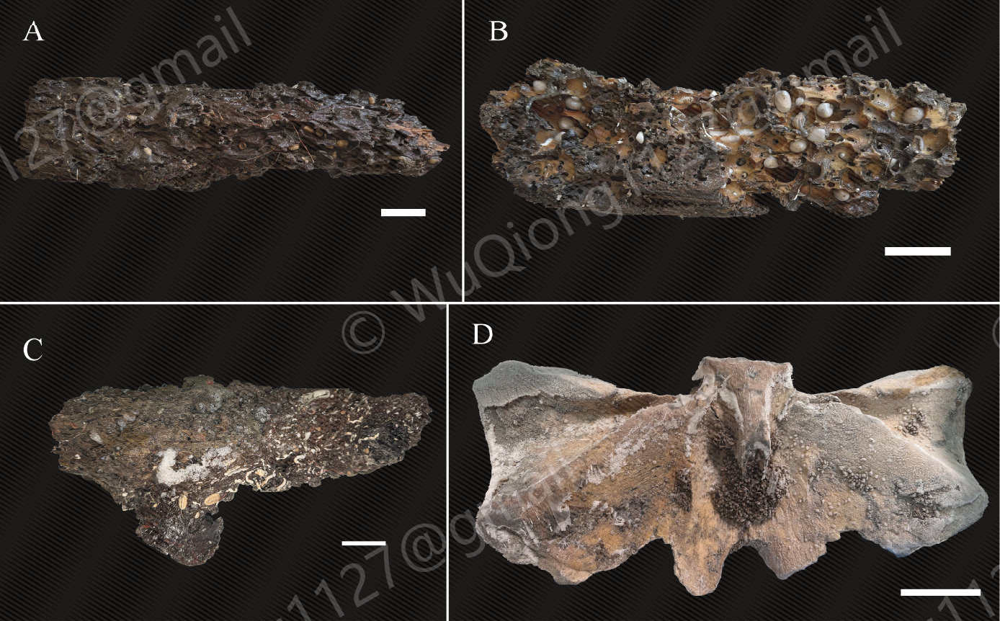
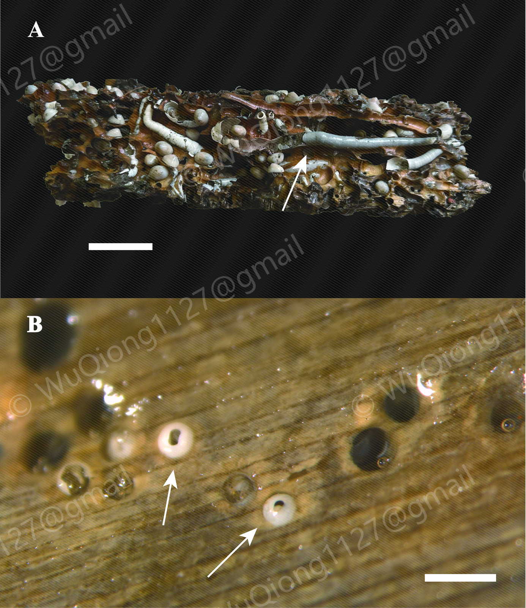

# Organic-Fall Molluscs

**A regularly updated database of molluscs associated with organic falls in the China seas.**

[**Browse the taxon index**](species/index.md)

[Bivalvia](species/index.md#bivalvia) · [Gastropoda](species/index.md#gastropoda) · [Polyplacophora](species/index.md#polyplacophora)

## What are organic falls?

Organic falls form when wood, whale remains or other organic material sinks to the seafloor. They provide concentrated sources of food and habitat for benthic organisms, including many specialized molluscs. As the material decomposes, microbial activity can generate sulfide-rich microhabitats that support chemosynthetic communities.[^background]

## Substrate gallery

Examples of organic-fall substrates and their associated fauna.

  

*Recovered organic-fall substrates, including sunken wood and whale bone, with associated fauna.*

  

*Molluscs associated with sunken wood, shown at different scales.*

## About the database

**Organic-Fall Molluscs** brings together information on molluscs associated with organic falls, with current coverage focused on sunken wood, bamboo and whale bones from the East China Sea and South China Sea.

Taxon pages include taxonomic information, substrate sample identifiers, collection localities and depths, specimen photographs, and links to available molecular sequences and publications. Coverage varies among taxa as records and resources are added.

Start with the [taxon index](species/index.md) to explore the available records.

## Ongoing updates

**This database is maintained as an independent resource and updated regularly.** New collection records, photographs and molecular resources are added as they become available. Existing entries are revised as identifications and taxonomic information are refined.

[^background]: Bienhold, C., Pop Ristova, P., Wenzhöfer, F., Dittmar, T., & Boetius, A. (2013). [How deep-sea wood falls sustain chemosynthetic life](https://doi.org/10.1371/journal.pone.0053590). *PLoS ONE*, 8(1), e53590.
