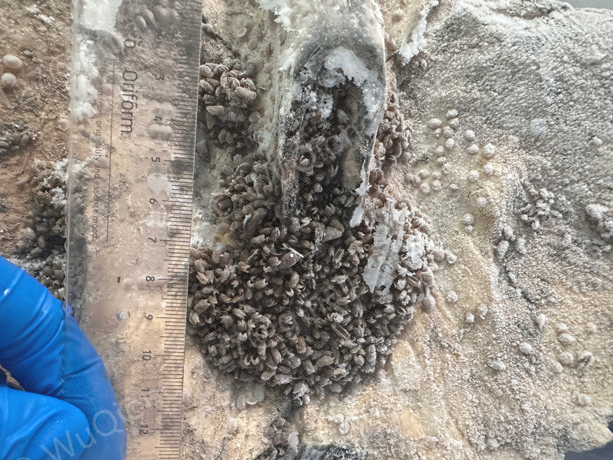
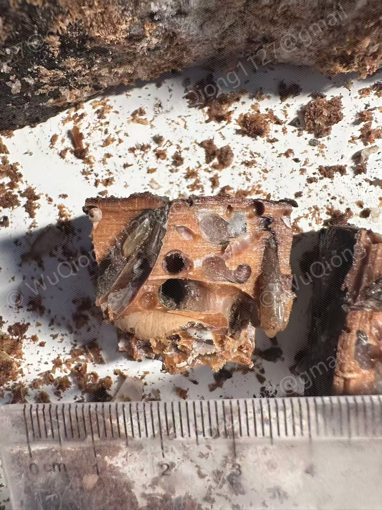

# Organic-Fall Molluscs

**A regularly updated database of molluscs associated with organic falls in the China seas.**

[**Browse the taxon index**](species/index.md)

[Bivalvia](species/index.md#bivalvia) · [Gastropoda](species/index.md#gastropoda) · [Polyplacophora](species/index.md#polyplacophora)

## What are organic falls?

Large organic falls form when wood, whale remains or other substantial organic material reaches the seafloor. They provide localized sources of food and shelter for benthic communities, including many specialized molluscs. As microorganisms decompose the substrate, oxygen depletion and sulfate reduction can create sulfide-rich microhabitats that support chemosynthetic production. The resulting habitats change as the organic material is consumed and degraded.[^background]

Molluscs contribute to these communities in several ways. Wood-boring bivalves break down and fragment wood, modifying its structure and creating resources for other organisms. Other molluscs graze microbial films, consume detritus or animal material, or prey on associated fauna. Bathymodioline mussels occur on substrate surfaces and within spaces in the wood, and some species obtain part of their nutrition through associations with chemosynthetic bacteria. These different ways of using the substrate contribute to the diversity of organic-fall assemblages.

Organic falls are scattered, temporary habitats whose communities vary with substrate type and size, depth, decomposition stage and colonization history. Some of their inhabitants are related to taxa found at hydrothermal vents and cold seeps, making organic falls important for investigating dispersal and evolutionary connections among reducing habitats. Records from the Chinese seas remain geographically uneven, and many lineages require further taxonomic study. Accessible occurrence records, photographs and molecular resources provide a basis for documenting this diversity and comparing communities across substrates and regions.

## Substrate gallery

Examples of organic-fall substrates and their associated fauna.

  

*Recovered organic-fall substrates, including sunken wood and whale bone, with associated fauna.*

  

*Molluscs associated with sunken wood, shown at different scales.*

<table>
  <tr>
    <td width="50%" align="center"><strong>Whale-bone habitat</strong></td>
    <td width="50%" align="center"><strong>Mussels inside sunken wood</strong></td>
  </tr>
  <tr>
    <td width="50%" valign="top"></td>
    <td width="50%" valign="top"></td>
  </tr>
  <tr>
    <td valign="top">Whale-bone substrate and its associated fauna.</td>
    <td valign="top">A cut section of sunken wood revealing bathymodioline mussels within the substrate.</td>
  </tr>
</table>

## About the database

**Organic-Fall Molluscs** brings together information on molluscs associated with organic falls, with current coverage focused on sunken wood, bamboo and whale bones from the East China Sea and South China Sea.

Taxon pages include taxonomic information, substrate sample identifiers, collection localities and depths, specimen photographs, and links to available molecular sequences and publications. Coverage varies among taxa as records and resources are added.

Start with the [taxon index](species/index.md) to explore the available records.

## Ongoing updates

**This database is maintained as an independent resource and updated regularly.** New collection records, photographs and molecular resources are added as they become available. Existing entries are revised as identifications and taxonomic information are refined.

[^background]: Bienhold, C., Pop Ristova, P., Wenzhöfer, F., Dittmar, T., & Boetius, A. (2013). [How deep-sea wood falls sustain chemosynthetic life](https://doi.org/10.1371/journal.pone.0053590). *PLoS ONE*, 8(1), e53590.
