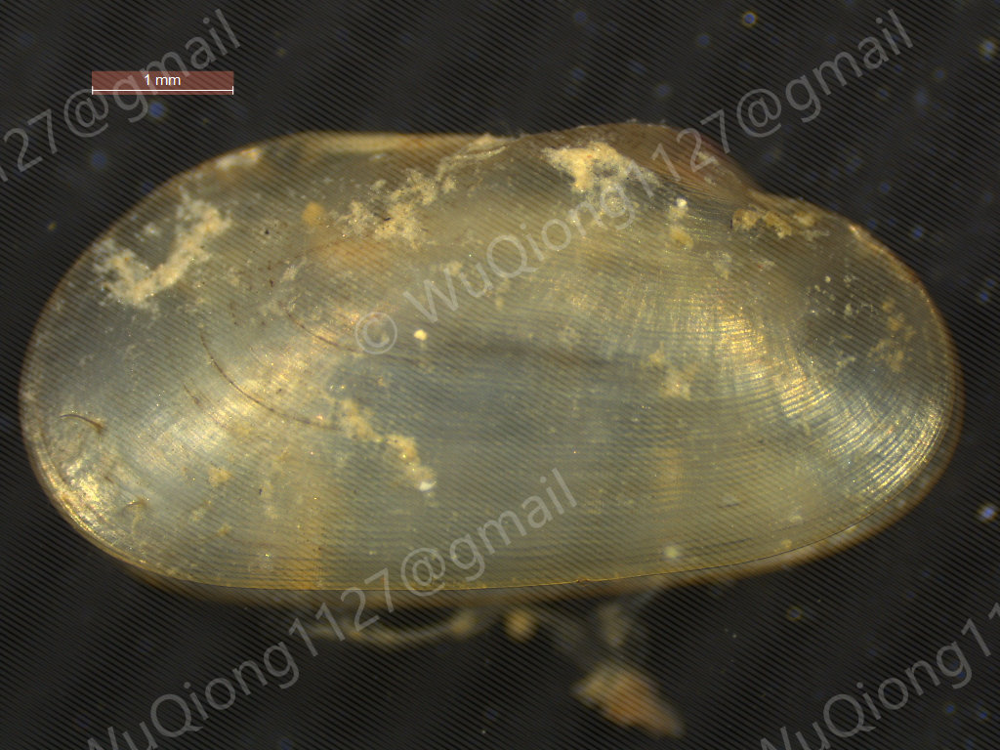

# *Idas* sp. SAL1

[Back to the taxon index](index.md)

## Taxonomy

**Class:** Bivalvia  
**Family:** Modiolidae  
**Genus:** *Idas*  
**Species / taxon:** *Idas* sp. SAL1  
**WoRMS AphiaID:**   

## Distribution

**Recorded region:** South China Sea  
**Locality:** See the coordinates in the sampling records below.  
**Sampling-depth envelope:** 300–500 m  

Depth values describe substrate recovery. The range summarizes recorded samples.

## Organic-fall habitat

**Substrate:** Wood  
**Substrate organism:**   

## Sampling records

| Substrate Sample ID | Region | Substrate | Latitude | Longitude | Sampling depth (m) |
| --- | --- | --- | --- | --- | --- |
| 2025PHI0409B | South China Sea | Wood | 10°40′N | 114°20′E | 300–500 |

## Material availability

- Voucher specimens:
- Tissue:
- DNA:
- RNA:

## Molecular resources

- COI: [PZ326607](https://www.ncbi.nlm.nih.gov/nuccore/PZ326607)
- 16S:
- 18S: [PX115903](https://www.ncbi.nlm.nih.gov/nuccore/PX115903)
- 28S: [PX121792](https://www.ncbi.nlm.nih.gov/nuccore/PX121792)
- H3: [PX132884](https://www.ncbi.nlm.nih.gov/nuccore/PX132884)
- HSP70: [PX124065](https://www.ncbi.nlm.nih.gov/nuccore/PX124065)
- Mitogenome: [PV926303](https://www.ncbi.nlm.nih.gov/nuccore/PV926303)
- Genome:
- Transcriptome:

## Images

**Representative image:**   
**Image type:**   

<!-- After uploading an image, uncomment this line: -->
<!--  -->

**Image credit:**   

## Publications

- Wu, Q., Xing, B. P., Qiu, J.-W., Li, C., Lin, M., & Wang, C. G. (2026). Molluscan diversity and community composition of wood and whale bone falls in the East and South China seas (Unpublished).
- Wu, Q., Zhou, Q., Xiang, P., Chen, Y., Wang, C. W., & Xing, B. (2026). Mitogenomic diversity and phylogenetic placement of organic-fall mussels (Bathymodiolinae) from the Chinese seas. Deep Sea Research Part I: Oceanographic Research Papers, 231, 104740. https://doi.org/10.1016/j.dsr.2026.104740 

## Notes

**Notes:**   

<!-- Empty fields are retained for later editing. -->
